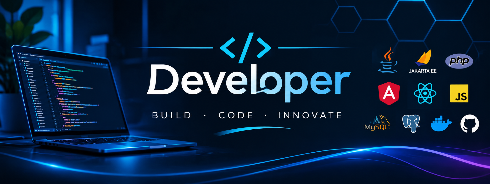

# **Donato Ramos Martínez**

## 👨‍💻 Sobre mí

Soy profesional del desarrollo de software, con orientación **Full Stack** y experiencia en entornos tecnológicos empresariales.

Mi actividad abarca tanto el desarrollo de aplicaciones web (frontend y backend) como la gestión de aplicaciones empresariales, participando en diferentes fases de su ciclo de vida: desarrollo, mantenimiento, control de versiones, gestión de dependencias, distribución de artefactos y seguimiento de proyectos.

### 💻 Desarrollo de software

Trabajo con diferentes lenguajes, tecnologías y frameworks, con especial interés en el ecosistema **Java, Jakarta EE y Spring**, así como en el desarrollo frontend con **Angular, TypeScript y JavaScript**.

También cuento con conocimientos en PHP, React, SQL y diferentes sistemas gestores de bases de datos relacionales.

### 🏢 Gestión de aplicaciones empresariales

Tengo experiencia trabajando con herramientas y plataformas utilizadas en entornos corporativos para gestionar aplicaciones, repositorios, versiones, artefactos y procesos de desarrollo.

Entre las principales herramientas con las que trabajo se encuentran:

- **Gestión de proyectos:** Jira.
- **Control de versiones:** Git, GitHub, GitLab y Apache Subversion (SVN).
- **Gestión de artefactos y repositorios:** Sonatype Nexus y JFrog Artifactory.
- **Integración y automatización de procesos:** Jenkins.

### ⚙️ Entornos y tecnologías

Trabajo con diferentes entornos de desarrollo y servidores de aplicaciones, entre ellos **WildFly, Open Liberty y Apache Tomcat**, además de tecnologías de contenedores como Docker y sistemas Linux.

### 🎯 Filosofía profesional

Me considero una persona autodidacta, constante y comprometida con la calidad del software y la mejora continua.

Me interesa comprender en profundidad las tecnologías, los procesos y las herramientas que intervienen en el desarrollo y la gestión de aplicaciones empresariales, buscando siempre soluciones eficientes, estructuradas y mantenibles.

**Mi objetivo es seguir evolucionando profesionalmente, combinando el desarrollo de software con el conocimiento de los entornos y procesos tecnológicos que permiten gestionar aplicaciones empresariales de forma eficiente.**
